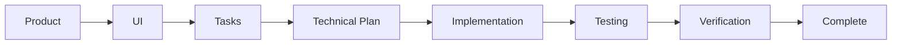
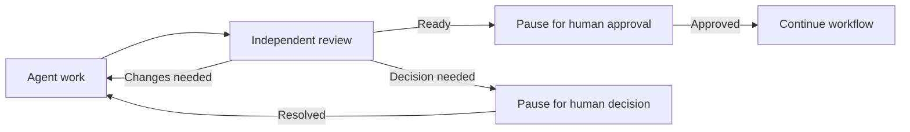

# PDLC

**From idea to shipped code, with agents doing the work and you making the decisions.**

PDLC coordinates coding agents through reviewed work recorded in your issue tracker. Agents plan, implement, test, and review; the workflow pauses at human gates for your approval or decision.

- **Lifecycle as code.** Workflows define stages, transitions, review gates, and completion rules in Python. The included Feature workflow is available today; add or change workflows in code.
- **Durable evidence.** Work items hold progress, decisions, and review results in GitHub Issues + Projects or Azure Boards.
- **Reviewable delivery.** Tasks become linked, stacked GitHub pull requests, with independent reviews and CI checks.
- **Your toolchain.** Project configuration routes work to your own skills and specialist agents.

## Lifecycle

The included [Feature workflow](src/pdlc/domain/workflows/workflow_feature.py) defines this path; other coded workflows can define their own:



Human gates pause the agent loop. Work resumes after you approve or resolve the decision.



## Installation

Clone this repository and run the setup script from its root. Use Bash on macOS, Linux, or WSL, or PowerShell 5.1+ on Windows.

### Install yourself

| Tool | Purpose |
|---|---|
| [Git](https://git-scm.com/downloads) | Clone the repository and manage worktrees. |
| [uv](https://docs.astral.sh/uv/getting-started/installation/) | Python package and tool manager; installs Python and the PDLC CLI. |
| [GitHub CLI (`gh`)](https://cli.github.com/) | GitHub Issues, Projects, pull requests, and CI. |
| [Azure CLI (`az`)](https://learn.microsoft.com/cli/azure/install-azure-cli) | Optional; needed only for Azure DevOps work item management. |

```bash
git clone https://github.com/wsimf/pdlc.git
cd pdlc
./setup.sh
```

On Windows, run `.\setup.ps1` instead of `./setup.sh`. Windows symbolic links require Developer Mode or an administrator shell; see [Microsoft's symbolic link guidance](https://learn.microsoft.com/en-us/powershell/module/microsoft.powershell.management/new-item#example-7-create-a-symbolic-link-to-a-file-or-folder). The Windows script has not yet been tested on Windows.

### Setup installs

- Python 3.12+ if no compatible interpreter is installed.
- The `gh stack` extension if missing.
- The optional `azure-devops` extension if Azure CLI is installed.
- Skills linked into `~/.agents/skills`, plus `~/.claude/skills` when Claude is present.
- Sub-agents for detected Claude, Codex, and Copilot directories; Claude/Copilot files are linked, Codex files are copied.
- The PDLC CLI, installed or updated from this checkout through uv.

Setup pulls the latest code first and prompts before Python/extension installs and each link/copy group. Use `./setup.sh -y` or `.\setup.ps1 -Yes` to accept all prompts. Rerun the same script to update or retry; matching links and agent files are replaced, unrelated files are preserved. Keep the checkout in place because skills link to it.

Sign in with `gh auth login` and, if using Azure, `az login`. Then run `pdlc setup` from your project repository to configure work item management. If `pdlc` is missing from PATH, run `uv tool update-shell` and reopen your shell.

## Worktrees

Use `pdlc prepare` from your project repository to create or reopen a dedicated Git worktree for a work item, then point your agent at that folder:

```bash
cd "$(pdlc prepare 142)"
```

For work that depends on another unmerged item, use `pdlc prepare my-feature --after 141`. Optional `[worktree]` configuration sets the root, base ref, and init script.

Once the item is Complete, run `pdlc cleanup 142` from your main checkout to remove its worktree and local delivery branches. These are human-run helpers.

## Development

```bash
uv sync --locked
uv run pdlc --help
uv run ruff check src tests
uv run mypy
uv run python -m unittest discover -s tests -p 'test_*.py'
uv build
```

Run from a local checkout without installing with `uv run pdlc ...`.


Ruff checks all source and tests; the strict mypy baseline covers normalized records, host ports, and shared process/storage boundaries (the files are listed in `pyproject.toml`).
CI runs these checks, the full test suite, and packaging on Python 3.12–3.14.
Provider tests use the replay transports in `tests/_gh_replay.py` and `tests/_az_replay.py`; the old `PDLC_ITEMS_FILE` and `PDLC_SUBISSUES_FILE` fixture switches have been removed from production configuration.

### Provider organization

`src/pdlc/hosts/{azure,github,file,none}_provider.py` exposes each provider's concrete implementations.
Implementation details live together under `hosts/lib/azure/`, `hosts/lib/github/`, `hosts/lib/file/`, and `hosts/lib/none/`.
The `workitem_host/`, `code_host/`, and `attachment_host/` packages retain their neutral ports and configured factories, so Azure Boards can still pair with GitHub code hosting.
`domain/records.py` defines normalized data contracts; task publication passes validated `bodyText`, never a file path, across the work-item port.
`domain/task_plan.py` owns pure task validation and dependency policy, while `internal/inputs.py` owns file/stdin handling.

The CLI accepts explicit argument lists through `main(argv=...)` and resets its host/configuration caches between invocations.
Environment overrides remain available during a command and are restored afterwards; concurrent embedded CLI calls are not supported.

### Local-store writes

File-store inspection does not initialize missing directories.
Writes use UTF-8 atomic file replacement and a fail-fast `$PDLC_HOME/.writer.lock` directory to exclude concurrent writers.
An interrupted writer may leave this lock behind: confirm that no writer is running before removing that directory and retrying.
Atomic replacement protects individual files, not an entire multi-file workflow transaction.
Azure task publication recovers an unlinked task by exact stable identity on retry and rejects ambiguous or foreign-parent matches.
CLI transport failures remain explicit; a timeout after a write requires inspection of remote state before retry.

Inspect comments without loading the full discussion with `pdlc inspect comments ISSUE --page N`. Pages contain 100 comments, are newest first, and report the exact total plus the next command when more remain.

## Configuration

Configuration is file-first. Settings live in `.pdlc/config.toml` at the repository root, layered over `~/.pdlc/config.toml` for machine-wide defaults, with CLI options (`--tracker-repo`, `--tracker`, `--project-number`, `--project-owner`, `--home`) on top for a single run.

Only two settings are read from the process environment, because they identify *where* things are before any config file is located:

| Variable | Default | Purpose |
|---|---|---|
| `PDLC_TRACKER_REPOSITORY` | unset | GitHub tracker repository in `OWNER/REPOSITORY` form; below `[tracker.github] repository` in every config file. Falls back to the checkout's `origin` remote (HTTPS or SSH) when nothing sets it; an SSH host alias that hides `github.com` is not resolved. |
| `PDLC_HOME` | `.pdlc` | Local file-tracker and attachment storage root; overrides `[runtime] home`. |
| `PDLC_DEBUG` | unset | `true` turns on external-call tracing before a config file is read; equivalent to `[debug] enabled = true`. |

Every other setting is a `.pdlc/config.toml` key. All are optional unless a selected tracker, code provider, or workflow requires them:

| Table / key | Default | Purpose |
|---|---|---|
| `[tracker] provider` | `github` | Where work items live: `github`, `azure`, or `file`. |
| `[tracker.github] repository` | checkout `origin`; required for GitHub | GitHub repository holding work-item Issues, in `OWNER/REPOSITORY` form. Several code repositories can share one tracker. |
| `[tracker.github] project_number` | unset; required for GitHub | GitHub Projects number. |
| `[tracker.github] project_owner` | unset; required for GitHub | GitHub Projects owner. |
| `[tracker.github] assigned_to` | unset | Optional. When set, the GitHub queue scan only returns Issues assigned to this login; `@me` resolves to the authenticated user. New records and task Issues are assigned to this login, or to the authenticated user when unset. |
| `[tracker.azure] organization` | unset; required for Azure | Azure DevOps organization URL, e.g. `https://dev.azure.com/OWNER`. |
| `[tracker.azure] project` | unset; required for Azure | Azure DevOps project name. |
| `[tracker.azure] record_type` | `Product Backlog Item` | Work-item type used for a PDLC record. Set to `User Story` on an Agile process. |
| `[tracker.azure] area_path` | Project root | Optional. Area path new records are created under, e.g. `PROJECT\Team`. Delivery tasks always inherit their parent record's area path. |
| `[tracker.azure] closed_state` | `Done` | Work-item state a record is closed into by `pdlc post complete`. Falls back for `task_closed_state` when that is unset. `Closed` is always recognized as terminal for a delivery task regardless of this setting. |
| `[tracker.azure] open_state` | `To Do` | Work-item state name. Falls back for `task_open_state` when that is unset. |
| `[tracker.azure] task_closed_state` | Falls back to `closed_state` | Delivery task (`Task`) state closed into. Set this when the record type and `Task` use different state vocabularies. |
| `[tracker.azure] task_removed_state` | Falls back to `task_closed_state` | Delivery task state a task descoped by `pdlc post tasks` moves to. Set `Removed` on Agile or Scrum so descoped work does not count as completed; Basic has no such state. |
| `[tracker.azure] task_open_state` | Falls back to `open_state` | Delivery task (`Task`) state a task is reopened into by `pdlc post invalidate` when it targets `Technical Plan` or `Implementation`. |
| `[tracker.azure] task_in_progress_state` | unset | Optional. No work-item fallback — set explicitly if your process has an in-progress `Task` state you want recorded. |
| `[tracker.azure] assigned_to` | unset | Optional. When set, the Azure queue scan only returns records assigned to this identity (display name or unique name); `@me` maps to Azure's `@Me` WIQL macro. New records and tasks are assigned to this identity, or to the signed-in `az` account when unset. |
| `[code] provider` | Follows `[tracker] provider`; `none` for `azure` | Where pull requests live: `github`, `file`, or `none`. |
| `[code.github] repository` | checkout `origin`, else `[tracker.github] repository`; required for GitHub | GitHub repository holding pull requests, in `OWNER/REPOSITORY` form. Set it only when `origin` is not a github.com URL or PRs open on another repository. |
| `[code] pr_attachment` | unset | Optional line inserted as the first line of each task PR body when `pdlc post implement-task` submits the stack. Every `{work.number}` is replaced with the parent work item's bare number (no `#`), and every `{work.ref}` with a reference that links it from the code repository (`#N`, `OWNER/REPOSITORY#N` for another GitHub tracker repository, or `AB#N` for Azure Boards). PR body only — never added to the `## Implementation` comment. |
| `[code] pr_title_format` | unset | Optional format string for each task PR title when `pdlc post implement-task` submits the stack. Placeholders: `{task.title}` (the delivery task's title, with its `WORK-N-TASK-N` id prefix and `[CORE]`/`[UI]` tag stripped), `{task.id}` (e.g. `TASK-001`), `{work.number}` (the parent's bare number), `{work.type}` (`feature`/`bug`), `{work.ref}`. Unset uses the bare stripped task title; the `[CORE]`/`[UI]` tag is dropped either way. |
| `[attachments] provider` | `file` | Where attachments live: `file` or `none`. |
| `[runtime] home` | `.pdlc` | Local file-tracker and attachment storage root (see also `PDLC_HOME`). |
| `[runtime] actor` | `local` | Actor name recorded by the file tracker. |
| `[runtime] ref_label` | `pdlc` | Label used for local inspector scratch files. |
| `[cache] root` | `repository_default` | Parent of `.pdlc/cache/<workitem>/` for generated inspector reports and prompt briefs. `repository_default` uses the repository root; `global_default` uses the user's home; a custom absolute path uses that directory, and a relative path is resolved from the repository root. Each filename ends in a random suffix. Short-lived GitHub/Azure request bodies use the `unscoped` subdirectory and are removed after the request. |
| `[workflow] max_attempts` | `5` | Maximum queue-loop polling attempts. |
| `[workflow] initial_delay_seconds` | `60` | Initial queue-loop retry delay. |
| `[workflow] max_delay_seconds` | `900` | Queue-loop retry delay ceiling. |
| `[workflow] no_sleep` | `false` | `true` skips queue-loop retry sleeps; CI monitoring retains its own wait policy. |
| `[worktree] root` | `~/.pdlc/worktrees` | Parent directory for `pdlc prepare` / `pdlc cleanup` worktrees; each is nested `<root>/<repo-name>/<workitem>`. |
| `[worktree] base_ref` | detected default branch | Ref that new `pdlc prepare` branches start from. |
| `[worktree] init_script` | unset | Shell snippet `pdlc prepare` offers to run in a freshly created worktree. |
| `[debug] enabled` | `false` | `true` appends every external CLI call (`az`, `gh`, `git`, …) to `~/.pdlc/debug.log` as `[<time>] - (<tool>) : <full command>`. |

For GitHub, create `.pdlc/config.toml` with:

```toml
[tracker]
provider = "github"

[tracker.github]
repository = "OWNER/REPOSITORY"   # optional; defaults to origin. Name a shared tracker here
project_number = 123
project_owner = "OWNER"
assigned_to = "@me"          # optional; scope the queue scan to your Issues
```

For Azure Boards, the tracker and the code provider are separate choices — Azure Boards paired with GitHub repositories is the expected setup:

```toml
[tracker]
provider = "azure"

[tracker.azure]
organization = "https://dev.azure.com/OWNER"
project = "PROJECT"
record_type = "Product Backlog Item"   # optional; defaults to "Product Backlog Item"
area_path = "PROJECT\\Team"  # optional; defaults to the project root
closed_state = "Done"        # optional; defaults to "Done"
open_state = "To Do"         # optional; defaults to "To Do"
assigned_to = "@me"          # optional; scope the queue scan to your work items

[code]
provider = "github"
pr_attachment = "Fixes {work.ref}"   # optional; first line of each task PR body
pr_title_format = "[{work.number}] {task.title}"   # optional; each task PR title

[code.github]
repository = "OWNER/REPOSITORY"   # optional; defaults to origin, else the tracker repository
```

`assigned_to` is optional: when set, `pdlc next` and the queue scan only surface records assigned to that identity (`@me` is Azure's `@Me` macro), and new records and tasks are assigned to it; when unset, the queue is unfiltered and new records and tasks are assigned to the signed-in account. The GitHub tracker has the same optional `assigned_to` under `[tracker.github]`.

Only `organization` and `project` are required by the tracker itself. The code repository belongs to the *code provider*, not the tracker — the two are validated independently, so `provider = "none"` under `[code]` needs no repository at all.

`record_type` is more than a creation default: it is how PDLC recognizes a work item as a record rather than an ordinary board item, and it is the type the queue scan filters on. If you change it, the [custom fields](#azure-boards-fields) have to exist on that type instead.

Run `pdlc setup` to create this file interactively. It detects the GitHub repository from `remote.origin.url`, asks which repository holds work items, lists available GitHub Projects with `gh`, and lets you choose the project owner or enter another owner.

### GitHub Project fields

`pdlc setup` does not create Project fields. Add these to the GitHub Project (v2) by hand before running any workflow command; PDLC reads and writes work-item state through them and fails if a field or option name is missing. Names are matched exactly.

| Field | Type | Options / contents |
|---|---|---|
| `Status` | Single select | `Product`, `UI`, `Tasks`, `Technical Plan`, `Implementation`, `Testing`, `Verification`, `Complete` — stages of the included Feature workflow. |
| `Gate State` | Single select | `Pending`, `Review Required`, `Changes Required`, `Decision Required`, `CI Pending`, `Approval Required`, `Approved`, `Stale` — where the current stage sits (pending work, under review, needs a human decision, blocked on CI, awaiting approval, approved, or stale after upstream change). |
| `Lifecycle` | Single select | `Planning`, `Completed` — `Completed` is set only by `pdlc post complete`; everything else stays `Planning`. |
| `Slug` | Text | Short work-item identifier stamped once at creation and never overwritten. |
| `Skipped States` | Text | Comma-separated list of lifecycle stages declared skipped ahead of time via `pdlc post skip`. |

The `file` backend mirrors the same field names under `PDLC_HOME`, so no manual setup is needed there.

### Azure requirements

The Azure backend shells out to the Azure CLI — there is no Python SDK dependency, and `pdlc` never stores a PAT or any other credential of its own. Everything below is verified against Azure CLI `2.90.0` with the `azure-devops` extension `1.0.8`.

| Requirement | How to satisfy | Why |
|---|---|---|
| Azure CLI (`az`) | `brew install azure-cli` | Every Boards read and write is an `az` subprocess. `pdlc` fails with `required command not found: az` if it is missing. |
| `azure-devops` extension | `az extension add --name azure-devops` | **Not bundled with the Azure CLI.** `az` offers to install it on first use, but that prompt fails in CI or any non-interactive run. For unattended environments set `az config set extension.use_dynamic_install=yes_without_prompt` instead. |
| A signed-in account | `az login` | `az boards` and `az devops` authenticate as the signed-in identity, and `pdlc` reads `az account show` to record the acting user on evidence comments. A PAT supplied through `az devops login` authorizes Boards calls but leaves `az account` empty, so prefer `az login`. |
| Project access | Contributor on the Azure DevOps project | The backend creates work items, edits fields, adds parent links, and posts comments. Read-only access fails on the first `pdlc post` command, not at configuration time. |
| GitHub CLI (`gh`), authenticated | `gh auth login` | Only when the code host is `github`, which is the expected pairing. Pull requests, branches, and CI status come from `gh`; Azure Boards supplies work-item state alone. |

On a fresh machine that is the whole client-side setup:

```bash
az extension add --name azure-devops
az login
```

No `az devops configure --defaults` setup is needed: `pdlc` passes `--organization` and `--project` explicitly on every call, so it is unaffected by, and does not disturb, your local `az` defaults. The same machine can therefore drive several organizations without a global mode switch.

Two things are organization-admin work that `pdlc` deliberately never attempts, because both need permissions a workflow run should not hold:

- **The custom fields**, which require an inherited process. See [Azure Boards fields](#azure-boards-fields) below for the full list and the process for adding them.
- **The project itself**, if it does not exist yet, which must be created against that inherited process. The `az devops project create` command is at the end of the next section.

### Azure Boards fields

Azure Boards has no project-level field layer: fields live on the work-item type and can only be added through a customized (inherited) process, which needs organization-admin rights. There is no `az` command for this and `pdlc` never attempts it — treat the fields below as a prerequisite an admin satisfies once per organization, before anyone runs a workflow command.

In **Organization settings → Process**, create an inherited process from **Scrum** (right-click the process → *Create inherited process*), then add these fields. The reference name is derived from the display name automatically, so enter `PdlcStatus` and Azure stores it as `Custom.PdlcStatus` — do not type the `Custom.` prefix yourself.

Add all six to **`Product Backlog Item`**, the work-item type PDLC uses for a record (use `User Story` instead if you inherit from Agile and set `record_type` accordingly):

| Field | Type | Options / contents |
|---|---|---|
| `PdlcStatus` | Picklist (string) | `Product`, `UI`, `Tasks`, `Technical Plan`, `Implementation`, `Testing`, `Verification`, `Complete` — stages of the included Feature workflow. |
| `PdlcGateState` | Picklist (string) | `Pending`, `Review Required`, `Changes Required`, `Decision Required`, `CI Pending`, `Approval Required`, `Approved`, `Stale` — where the current stage sits. |
| `PdlcLifecycle` | Picklist (string) | `Planning`, `Completed` — `Completed` is set only by `pdlc post complete`; everything else stays `Planning`. |
| `PdlcSkippedStates` | Text (single line) | Comma-separated list of lifecycle stages declared skipped ahead of time via `pdlc post skip`. |
| `PdlcSlug` | Text (single line) | Short work-item identifier stamped once at creation and never overwritten. |
| `PdlcPrs` | Text (single line) | Space-separated pull-request numbers attached to the record. Written by `pdlc post implement` / `post test`. |

Add one field to **`Task`**, the work-item type PDLC uses for a delivery task:

| Field | Type | Options / contents |
|---|---|---|
| `PdlcPrs` | Text (single line) | Space-separated pull-request numbers attached to that task. Written by `pdlc post implement-task` / `post attach-pr`. |

Descriptions and evidence comments are written as Markdown, so they render properly in the Azure UI. PDLC sets that format when it creates a work item and whenever it edits its description; nothing needs configuring.

A delivery task carries no stage state of its own: its identity is the `WORK-<n>-TASK-NNN` prefix on its title, and its parent link is a normal `System.LinkTypes.Hierarchy-Forward` relation.

Option values are matched exactly and validated by Azure, so a typo surfaces on the first write as `The field 'PdlcGateState' contains the value '…' that is not in the list of supported values` rather than corrupting state. Confirm the fields landed on the right types with:

```bash
az devops invoke --organization https://dev.azure.com/<org> \
  --area wit --resource workitemtypes \
  --route-parameters project=<project> --api-version 7.1 -o json
```

Create the project against the inherited process once the fields exist:

```bash
az devops project create --organization https://dev.azure.com/<org> \
  --name <project> --process "<inherited process name>" --source-control git --visibility private
```

## Project capabilities

PDLC skills never name a project-specific skill or sub-agent. Each seam that could use a specialist reads its routing from `pdlc inspect capability <slot>` and injects the result into the sub-agent brief it builds. Declare routing in the `[agents]` and `[skills]` tables of `.pdlc/config.toml`:

```toml
[agents]
core-implementer = "my-core-implementer"
ui-implementer   = "my-ui-implementer"

[skills]
build-run         = "my-build-run"
ux-design         = "my-ux-design"
cumulative-review = "my-cumulative-review"
test-authoring    = "my-test-authoring"
test-framework    = "my-test-framework"
```

Every slot is optional; omit both tables and the workflow still runs with the fallback behaviour below.

| Slot | Kind | Plugged into | Unset behaviour |
|---|---|---|---|
| `core-implementer` | agent | `pdlc-implement` dispatch for `[CORE]` tasks | dispatch to `general-purpose` |
| `ui-implementer` | agent | `pdlc-implement` dispatch for `[UI]` tasks | dispatch to `general-purpose` |
| `build-run` | skill | `pdlc-tasks` acceptance criteria, `pdlc-implement` task dispatch, `pdlc-verify` UI-journey pass | agent builds and runs the app per `AGENTS.md` |
| `ux-design` | skill | `pdlc-ui-planner` | agent resolves design from `AGENTS.md` references and platform conventions |
| `cumulative-review` | skill | `pdlc-verify` cumulative review, `pdlc-implement` task review | agent performs the review inline over the change scope |
| `test-authoring` | skill | `pdlc-test-writer` | agent follows the existing test suite's conventions |
| `test-framework` | skill | `pdlc-test-writer` (reference only) | omitted |

Inspect the current wiring with `pdlc inspect capability` (every slot) or `pdlc inspect capability <slot>` (one paste-ready line). Full contract: `pdlc guide capabilities`.
