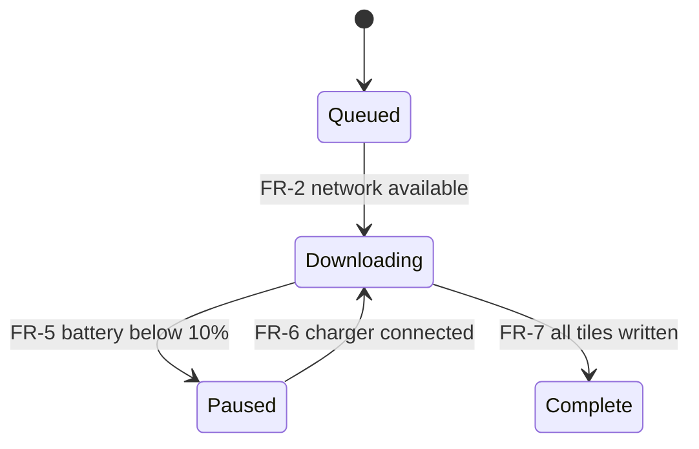
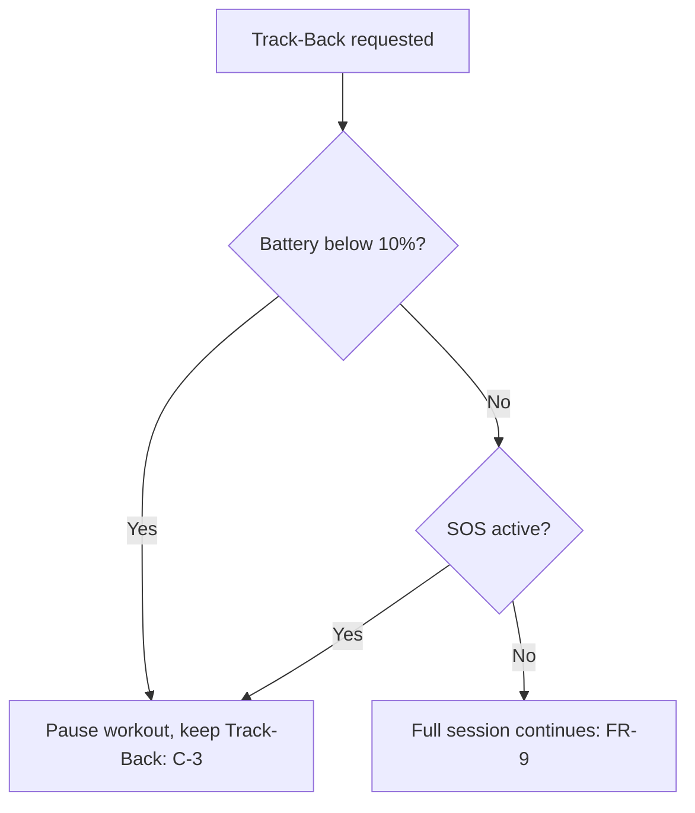

# Product specification format

A work item is a title plus named sections. Write **no frontmatter** — the body opens with the `## Product` heading.

**Title:** human-readable and free to reword later; it is never identity.
**Slug:** short kebab-case, derived from the title, stamped once at creation as the work item's `Slug` and never rewritten.

Write for a reader who may be a junior developer or an AI agent: be explicit and unambiguous, avoid jargon or explain it, give enough detail to understand purpose and core logic, and use concrete examples where they help.

Every section is a level-2 heading whose text is its exact name, and it runs until the next level-2 heading. That heading is the only anchor the commands have, so use these spellings verbatim and structure everything inside a section at level 3 or deeper:

```md
## Product
### Problem statement
...
## Decisions
## Open Questions
```

Three sections are authored here. `UI` and `Verification` are level-2 sections too, but they belong to later stages — never create them.

## Diagrams

Diagrams are optional, and never a section of their own — never write a `### Diagrams` heading. Each one goes inside the subsection it serves, named below.

A diagram earns its place only when it is the **authoritative** statement of something prose states badly. If it restates requirements you already numbered, it is a second source of truth that goes stale the first time a requirement is edited — leave it out.

Label every edge with the `FR-*` or `C-*` it encodes, so the diagram stays checkable against the text and `pdlc-tasks` can trace coverage from it.

**State machine** — when the feature introduces an entity that moves through states. Prose describes transitions one at a time and nobody notices the missing ones; a diagram makes an absent edge obvious. Belongs under Functional requirements.



**Decision flowchart** — when a rule branches three or more ways. Below three branches a sentence is clearer. Belongs under Constraints when the rule is binding, under Functional requirements when it is behaviour.



**Sequence** — only for multi-actor flows where *ordering itself* is the requirement, such as a watch/phone handoff or a background refresh racing a user tap. Participants must be actors or user-visible surfaces; components belong to `### Technical approach`.

Never draw `erDiagram` or `classDiagram` (technical plan), `journey` (the `UI` section owns experience flows), `gantt` (the tracked fields are the lifecycle record), or a scope-boundary flowchart (that is Non-goals with boxes round it).

## Section: `## Product`

Write these subsections in the order below, under their exact names. They are unnumbered on purpose: Design considerations is omitted whenever it has no content, and everything downstream — reviewers, `pdlc-plan`, the commands — finds a subsection by its name. Numbering them would only raise the question of whether to renumber or leave a gap.

### Problem statement
Two to four sentences: who is affected, what they cannot do today, and why it matters. State the problem, not the solution — no requirement restatement, no design, no feature tour. If it runs past a short paragraph, the detail belongs in Goals, Functional requirements, or the product evidence comment.

### Goals
Specific, measurable objectives (bullet list).

### Prior art & reuse
What already exists in the repo that this feature builds on, extends, or must not duplicate. Fill this from the Interview exploration — it is the written record of that search, and it is what saves the spike and `pdlc-plan` from repeating it.

Cite real file paths and type names, not descriptions:

```md
- `src/ui/components/Sheet` — existing detent/sheet container; extend rather
  than adding a second sheet abstraction.
- `ProfileFileService` (`src/services/profiles/`) — already owns geometry file
  IO keyed off `ProfileEntity.id`.
- Nothing currently models profile shape; `ShapeType` is new.
```

State "nothing existing" explicitly where that is the finding — an empty section reads as a section nobody filled in.

### Functional requirements
Numbered, testable statements of **behaviour**. Each names a trigger and the resulting behaviour, so it can become a test or a demo without further interpretation:

- "FR-1: When a profile's geometry is replaced, the stored shape is overwritten, including with `nil`."
- "FR-2: When the user taps a route on the map, the details sheet opens at the medium detent."

Invariants and "must never" rules have no trigger — write those unconditioned:

- "FR-3: A route profile never holds geometry for a different profile's id."

Write plain prose. Do not use screaming-caps EARS (`WHEN … THE SYSTEM SHALL`); the discipline is trigger-plus-behaviour, not the ceremony.

Be explicit and unambiguous. "Works correctly" is bad; "shows a confirmation dialog before deleting" is good. If a statement cannot be tested, it is not a functional requirement — it is a Constraint.

**Quality attributes are requirements too.** There is no separate non-functional section: a performance budget, an offline guarantee, a memory or power ceiling belongs here, as an `FR-*` with the number in it. Name the bound and the conditions it holds under, so it can be measured rather than argued about:

- "FR-4: A drawn segment of up to 5 km snaps and renders within 200 ms on a mid-range device."
- "FR-5: Snapping succeeds in airplane mode from the downloaded region package; no request leaves the device."

"Must be fast", "should be accessible", and "reasonable memory use" are not requirements — they are the absence of one. Give the bound or drop the line. Accessibility and localization behaviour is journey-level and belongs to the `UI` section, not here.

### Constraints
Binding design decisions that implementation is not free to relitigate. Not testable behaviours, but as binding as requirements — this is where decisions made during the Interview go.

Number them `C-1`, `C-2`, … so tasks can reference them alongside FRs:

- "C-1: `ShapeType` lives in the shared `profiles` package and is immutable and serializable."
- "C-2: Shape detection runs at profile-build time, never on a rendering path."

A quality attribute lands here when it binds the *mechanism* rather than the observable result — concurrency isolation, where work runs, what a type must conform to:

- "C-3: Snapping runs inside the Valhalla actor; no snapping work is scheduled on the main actor."

The same concern often splits across both, and that is correct rather than duplication: the `FR-*` is what a test asserts, the `C-*` is what a reviewer checks the diff against.

Every task must cover at least one FR or C, so keep both numbered and stable — renumbering an approved requirement breaks that coverage.

### Design considerations (optional)
Product-level experience constraints and links to supplied mockups. Do not decide UI applicability, journeys, surfaces, navigation, interaction states, accessibility behaviour, or UI tasks here — the `UI` section owns all of that, and components to reuse belong in Prior Art & Reuse.

### Success metrics
How success will be measured — "route details open with no perceptible delay after tap", "multi-day plan completes in under three minutes".

### Technical approach
How the product will be built and whether it can be, from a spike against current source: always the last subsection of Product. The feasibility spike writes it after the product review, following `pdlc template technical-approach`, and the technical review checks it; leave it out of the first draft. It is the one place in Product that names modules, boundaries, and data flow, and still names no files to edit, signatures, or task order.

## Assumptions from the spike

Nothing lands on an assumption. A spike may hand you assumptions it could not verify: confirm each one and fold it into the requirement or constraint it supports, or settle it with the driver. Never write an `### Assumptions` subsection into a draft that is going to land; the land command refuses one.

## Section: `## Decisions`

Alternatives considered and rejected, with the reason. Only the residue that has nowhere else to live: a decision that binds implementation is a **Constraint** and belongs in Product, not here.

Write each one as a numbered entry: the decision in bold on the first line, the rationale on the next, the reference on the last. Rationales are prose and a table column squeezes them into something nobody reads.

This section is the authored decision record. Decisions that emerge later live in task `## Implementation` notes and `PDLC-RESOLUTION` comments during delivery, and `pdlc-complete` captures them in the completion evidence — this section itself is frozen once Product is approved. Keep the three lines in this order, and write `Ref: —` for decisions made before any task existed:

```md
1. **Shape stored per profile, not on `RouteEntity`**
   Geometry is per-profile; storing it higher would duplicate the shape on every
   profile and leave the two able to disagree.
   Ref: —

2. **Detection runs at build time, not on read**
   Rendering paths must stay allocation-free, and a profile's geometry cannot
   change without a rebuild.
   Ref: #142
```

Numbering is positional and may be renumbered freely — unlike `FR-*` and `C-*`, nothing references a decision by its number.

## Section: `## Open Questions`

Implementation details nobody has decided yet, each one free to settle either way without changing any `FR-*` or `C-*`. A question whose answer would change a requirement or constraint is settled with the driver before landing, never left here. Every open question must be answered or explicitly deferred before the record can reach `Complete` — see `pdlc-complete`. Omit the section entirely when there are none; on an existing record, omitting it leaves the landed Open Questions unchanged.
