# PDLC workflow

This diagram is the enabled Feature pipeline. The resolved record's `workType` selects a pipeline once, at resolution, before any routing; a missing type uses Feature compatibility, while unknown types and registered-but-unavailable pipelines block. `Bug` is registered as a distinct work type but its pipeline is not yet available — its stage spine and evidence contract are deliberately not derived from Feature — so a `Bug` record blocks until that workflow is designed. When it lands it is its own `pdlc`-governed pipeline with its own diagram, selected by the same step shown here.

This flow describes how the parent work item, its state, delivery tasks,
and pull requests work together. The work item store is the system of record;
the focused `pdlc` commands enforce every work item mutation.

```mermaid
flowchart TD
    Start([Human names a work item<br/>or autonomous loop runs])
    New([Human supplies a fresh idea]) --> Write
    Resolve{"pdlc next resolves the record's workType<br/>→ selects a pipeline (once, at resolution)"}
    Next["pdlc next<br/>reads Status + Gate State"]

    Start --> Resolve
    Resolve -->|"Feature — or missing type (Feature compat)"| Next
    Resolve -->|"Bug — pipeline registered, not yet available"| BugPipeline["Bug pipeline<br/>own stage spine + evidence contract,<br/>not derived from Feature<br/>→ its own pdlc-governed diagram"]
    Resolve -->|"unknown type / unavailable pipeline"| Blocked
    BugPipeline -->|"until that workflow ships"| Blocked

    Next -->|Pending / Stale / Changes Required| Owner
    Next -->|"Product, any gate"| HumanInput["human-input<br/>autonomous loop stops,<br/>asks the driver to run pdlc-write"]
    Next -->|"Review Required (Implementation, Testing)"| Review["pdlc-review<br/>independent reviewer"]
    Next -->|"Review Required (UI, Tasks, Technical Plan):<br/>published without its local review"| Owner
    Next -->|Decision Required| Decision["human-decision<br/>pdlc guide decisions"]
    Next -->|CI Pending| CIWait["autonomous loop backs off<br/>while checks run;<br/>driver may run pdlc post ci"]
    Next -->|Approval Required| Human["Human approval required"]
    Next -->|"Skipped stage (Skipped States)"| SkipCascade["pdlc next auto-advances<br/>Pending / Changes / Stale straight to<br/>the next stage's Pending<br/>PDLC-SKIPPED, no specialist or reviewer"]
    Next -->|Complete| Done([No work])
    Next -->|"Malformed / unknown type / unavailable pipeline"| Blocked([Blocked: report exact state])

    SkipCascade --> Next
    CIWait --> CIGate
    HumanInput --> Write

    Decision --> DecisionLand["pdlc post decision<br/>manifest of per-decision outcomes<br/>(each answered, or deferred to its own<br/>Product / Pending work item)<br/>sets Changes Required"]
    DecisionLand --> Owner
    Decision -->|"resolution changes approved upstream intent"| Invalidate

    Invalidate["pdlc post invalidate — human<br/>returns a settled / Approved stage to Stale<br/>PDLC-INVALIDATED<br/>marks downstream evidence stale"]
    Invalidate --> Next
    Settled([Any Approved stage<br/>upstream intent changed]) --> Invalidate

    Owner{"Active stage"}

    Owner -->|Product| Write["pdlc-write — human only<br/>interview, draft, local review"]
    Owner -->|UI| UI["pdlc-tasks<br/>prepare UI section"]
    Owner -->|Tasks| Tasks["pdlc-tasks<br/>prepare delivery tasks"]
    Owner -->|Technical Plan| Plan["pdlc-plan<br/>prepare task plans"]
    Owner -->|Implementation| Implement["pdlc-implement<br/>select one eligible task"]
    Owner -->|Testing| Test["pdlc-test<br/>trace requirements to coverage"]
    Owner -->|Verification| Verify["pdlc-verify<br/>claims, journeys, UX, evidence"]

    Write --> LandProduct["pdlc post write<br/>lands at Product / Approval Required"]
    LandProduct --> Human
    UI --> DryRun
    Tasks --> DryRun

    DryRun["pdlc post tasks --dry-run<br/>guard stage + gate<br/>validate coverage, dependencies,<br/>UI applicability — writes nothing"]
    DryRun -->|"validation fails — hand problems to the sub-agent, re-run (no cap)"| UI
    DryRun -->|"validation fails — hand problems to the sub-agent, re-run (no cap)"| Tasks
    DryRun -->|"clean"| LocalReview["pdlc-tasks-reviewer<br/>reads the local files, not the record"]
    LocalReview --> LocalVerdict{Findings?}
    LocalVerdict -->|Changes, max 2 passes| UI
    LocalVerdict -->|Changes, max 2 passes| Tasks
    LocalVerdict -->|Clean| Land

    Land["pdlc post tasks<br/>replace UI section, or create/update<br/>delivery tasks<br/>post evidence<br/>set Approval Required"]
    Land --> Human

    Plan --> PlanDryRun["pdlc post plan --dry-run<br/>guard stage + gate<br/>validate plan fragments<br/>against the task tree — writes nothing"]
    PlanDryRun -->|"validation fails — hand problems to the sub-agent, re-run (no cap)"| Plan
    PlanDryRun -->|"clean"| PlanReview["pdlc-plan-reviewer<br/>reads the local task bodies"]
    PlanReview --> PlanVerdict{Findings?}
    PlanVerdict -->|Changes, max 2 passes| Plan
    PlanVerdict -->|Clean| PlanLand

    PlanLand["pdlc post plan<br/>post a ## Technical Plan comment per planned task<br/>post evidence<br/>set Approval Required"]
    PlanLand --> Human
    Test --> Publish

    Verify --> VResult{"pdlc post verify<br/>derived recommendation"}
    VResult -->|"Approval Required (clean run)"| CIGate
    VResult -->|Decision Required| Decision
    VResult -->|Changes Required| Verify
    VResult -->|"Changes Required + bounce STAGE"| Bounce["PDLC-REVIEW records Bounce + Loop<br/>STAGE → Stale, no driver step<br/>(advances the rework count)"]
    Bounce --> Next

    Implement --> TaskWork["Implement one task<br/>task-depth review<br/>PR + task evidence"]
    TaskWork --> TasksRemain{Any delivery tasks<br/>still open?}
    TasksRemain -->|Yes| Next
    TasksRemain -->|No| Publish

    Publish["pdlc post implement / pdlc post test<br/>complete transition<br/>post evidence<br/>set Review Required"]
    Publish --> Review

    Review --> ReviewResult{Findings?}
    ReviewResult -->|Changes required| Owner
    ReviewResult -->|Decision required| Decision
    ReviewResult -->|"Clean (Implementation, Testing)"| CIGate["CI Pending → pdlc post ci<br/>reconcile the registered PR stack's CI<br/>green → Approval Required<br/>red → Changes Required"]
    CIGate -->|"green, Implementation / Testing"| Churned{"Verification rework loop<br/>entered 1–3×?"}
    CIGate -->|"green, Verification"| Human
    CIGate -->|red| Owner
    Churned -->|no| Human
    Churned -->|yes| AutoApprove["PDLC-AUTOAPPROVED<br/>the CI gate skips the human step,<br/>advance to next stage Pending"]
    AutoApprove --> Next

    Human --> Approve["pdlc post approve<br/>post approval evidence<br/>advance to next stage Pending"]
    Approve --> Next

    Human -->|Verification only| Complete["pdlc post complete<br/>requires clean verification<br/>and all delivery tasks closed"]
    Complete --> Done
```

## Gate states per stage

Every `Status` stage carries the same `Gate State` shape, transitioned by a
fixed script and actor. Most stages depart from it. `Product`, `UI`, `Tasks`,
and `Technical Plan` are reviewed **before** publication, so their land script
(`pdlc post write` / `pdlc post tasks` / `pdlc post plan`) publishes straight
to `Approval Required`. It lands from `Pending`, `Stale`, and
`Changes Required` (where a resolved decision parks the stage). From
`Review Required` (an artifact published without its local review, e.g.
edited outside PDLC) or `Approval Required` (a driver change request), it
resets the gate to `Stale` itself and re-lands the reviewed artifact in the
same call. No `PDLC-INVALIDATED` comment: the artifact never settled at
`Approved`, so there is nothing to invalidate, and the re-land's own stage
evidence records the change. Nothing about it feeds the rework/churn count.
A landed, approved artifact is reworked by returning it to `Stale`. At
`Decision Required` every `pdlc post` command except `pdlc post decision` and
`pdlc post invalidate` refuses and points at `pdlc guide decisions`.
`Testing` keeps the full post-publication review shape; `Implementation` stays
`Pending` across multiple task loops before its first `Review Required`;
`Verification` skips `Review Required` entirely.

`Implementation`, `Testing`, and `Verification` are CI-gated: a clean stage review (`pdlc post review`) or a clean verification run (`pdlc post verify` with a report that derives `Approval Required`) lands `CI Pending`, not `Approval Required`, because the reviewer judges the work without waiting on the registered PR stack's CI.
The same command reconciles that CI straight away; while checks are still running the record stays at `CI Pending` until `pdlc post ci` reconciles it against the live check rollup — green (or nothing to wait on: no checks configured, or no registered PR on Verification) → `Approval Required`, red → `Changes Required` with a `PDLC-REVIEW` note naming the failed checks, which the stage's owning skill fixes; with no registered PR on Implementation or Testing it refuses and the record stays at `CI Pending`.
It is mechanical, carries no identity check, and the autonomous loop runs it unattended once checks finish; while they run, `pdlc next` reports the record as no work so the loop backs off.

Both `Implementation` and `Testing` approval gates are auto-cleared on a record that has demonstrably iterated the rework loop. The count comes only from Verification `PDLC-REVIEW` comments whose `verdict` is `Changes Required`, whose `bounce` names an upstream stage, and whose `loop` matches the pipeline's named rework policy. Between 1 and the selected pipeline's rework cap (three for Feature), the script that would set the gate advances straight past it instead: the CI gate on green CI posts a `PDLC-AUTOAPPROVED` comment and `set_state` to the next stage's `Pending`, so no human step and no later routing pass is involved. On the first pass, past the cap, and for `Verification` always, the gate still stops for the driver. A `pdlc post verify` report with a `bounce` stage advances the count and returns the named upstream stage to `Stale` without a driver step or `PDLC-INVALIDATED`; explicit driver invalidation remains separate and does not affect the loop count.

Both post-publication reviews (`Implementation`, `Testing`) can also land at
`Decision Required` instead of `Changes Required` when a finding needs a
product, architecture, UX, safety, or scope call from the driver, and
`Verification` can reach the same gate from its own audit
(`pdlc post verify` with a finding at `decision`). That
gate stops the autonomous loop with no reconciliation attempt;
`pdlc next` routes it to `human-decision`. The driver clears it through
`pdlc guide decisions`: `pdlc post decision` lands a
manifest of per-decision outcomes — each answered, or deferred into its own
`Product / Pending` work item — and moves the gate to `Changes Required`,
routing back to the stage owner. A decision that changes approved upstream
intent goes through `pdlc post invalidate` instead.

```mermaid
stateDiagram-v2
    [*] --> Product : pdlc post write — pdlc-write (human), reviewed spec only

    state Product {
        [*] --> P_Approval
        P_Pending --> P_Approval : pdlc post write — pdlc-write (human)
        P_Changes --> P_Approval : pdlc post write — pdlc-write (human)
        P_Stale --> P_Approval : pdlc post write — pdlc-write (human)
        P_Review --> P_Approval : pdlc post write — re-land after reviewing (gate reset to Stale first, no comment)
        P_Approval --> P_Approval : pdlc post write — driver change request (gate reset to Stale first, no comment)
    }
    note left of Product
        Product is reviewed before publication: pdlc-write
        drafts and has the specification reviewed locally
        before anything is written to the work item store.
    end note
    Product --> UI : pdlc post approve — human

    state UI {
        [*] --> U_Pending
        U_Pending --> U_Approval : pdlc post tasks — pdlc-tasks
        U_Stale --> U_Approval : pdlc post tasks — pdlc-tasks
        U_Changes --> U_Approval : pdlc post tasks — pdlc-tasks, after a resolved decision
        U_Review --> U_Approval : pdlc post tasks — re-land after reviewing (gate reset to Stale first, no comment)
        U_Approval --> U_Approval : pdlc post tasks — driver change request (gate reset to Stale first, no comment)
    }
    note left of UI
        UI and Tasks are reviewed before publication: pdlc-tasks
        has pdlc-tasks-reviewer review the manifest and files
        before pdlc post tasks writes anything to the work item store.
    end note
    UI --> Tasks : pdlc post approve — human

    state Tasks {
        [*] --> T_Pending
        T_Pending --> T_Approval : pdlc post tasks — pdlc-tasks
        T_Stale --> T_Approval : pdlc post tasks — pdlc-tasks
        T_Changes --> T_Approval : pdlc post tasks — pdlc-tasks, after a resolved decision
        T_Review --> T_Approval : pdlc post tasks — re-land after reviewing (gate reset to Stale first, no comment)
        T_Approval --> T_Approval : pdlc post tasks — driver change request (gate reset to Stale first, no comment)
    }
    Tasks --> TechnicalPlan : pdlc post approve — human

    state TechnicalPlan {
        [*] --> TP_Pending
        TP_Pending --> TP_Approval : pdlc post plan — pdlc-plan
        TP_Stale --> TP_Approval : pdlc post plan — pdlc-plan
        TP_Changes --> TP_Approval : pdlc post plan — pdlc-plan, after a resolved decision
        TP_Review --> TP_Approval : pdlc post plan — re-land after reviewing (gate reset to Stale first, no comment)
        TP_Approval --> TP_Approval : pdlc post plan — driver change request (gate reset to Stale first, no comment)
    }
    note left of TechnicalPlan
        Technical Plan is reviewed before publication:
        pdlc-plan has pdlc-plan-reviewer review the rebuilt
        task bodies before pdlc post plan writes any of them.
    end note
    TechnicalPlan --> Implementation : pdlc post approve — human

    state Implementation {
        [*] --> I_Pending
        I_Pending --> I_Pending : pdlc-implement — one task + PR per pass, any delivery task still open
        I_Pending --> I_Review : pdlc post implement — pdlc-implement, only once every delivery task is closed
        I_Changes --> I_Review : pdlc post implement — pdlc-implement
        I_Stale --> I_Review : pdlc post implement — pdlc-implement
        I_Review --> I_Changes : pdlc post review — pdlc-review (reviewer)
        I_Review --> I_Decision : pdlc post review — pdlc-review (reviewer), finding needs the driver
        I_Review --> I_CIPending : pdlc post review — pdlc-review (reviewer), clean review does not wait for CI
        I_CIPending --> I_Approval : pdlc post ci — CI green, or no checks configured
        I_CIPending --> I_Changes : pdlc post ci — CI red, PDLC-REVIEW note
        I_Decision --> I_Changes : pdlc post decision --manifest — driver (each decision answered or deferred to its own work item)
    }
    Implementation --> Testing : pdlc post approve — human
    Implementation --> Testing : pdlc post ci — CI green + reworked 1–3× (PDLC-AUTOAPPROVED, no human)

    state Testing {
        [*] --> Te_Pending
        Te_Pending --> Te_Review : pdlc post test — pdlc-test
        Te_Changes --> Te_Review : pdlc post test — pdlc-test
        Te_Stale --> Te_Review : pdlc post test — pdlc-test
        Te_Review --> Te_Changes : pdlc post review — pdlc-review (reviewer)
        Te_Review --> Te_Decision : pdlc post review — pdlc-review (reviewer), finding needs the driver
        Te_Review --> Te_CIPending : pdlc post review — pdlc-review (reviewer), clean review does not wait for CI
        Te_CIPending --> Te_Approval : pdlc post ci — CI green, or no checks configured
        Te_CIPending --> Te_Changes : pdlc post ci — CI red, PDLC-REVIEW note
        Te_Decision --> Te_Changes : pdlc post decision --manifest — driver (each decision answered or deferred to its own work item)
    }
    Testing --> Verification : pdlc post approve — human
    Testing --> Verification : pdlc post ci — CI green + reworked 1–3× (PDLC-AUTOAPPROVED, no human)

    state Verification {
        [*] --> V_Pending
        V_Pending --> V_Changes : pdlc-verify — finding (no Review Required stop)
        V_Pending --> V_CIPending : pdlc post verify — clean report, does not wait for CI
        V_Pending --> V_Decision : pdlc-verify — finding needs the driver
        V_Changes --> V_Changes : pdlc-verify — finding persists
        V_Changes --> V_CIPending : pdlc post verify — clean report
        V_Changes --> V_Decision : pdlc-verify — finding needs the driver
        V_Decision --> V_Changes : pdlc post decision --manifest — driver
        V_Stale --> V_Changes : pdlc-verify — finding
        V_Stale --> V_CIPending : pdlc post verify — clean report
        V_CIPending --> V_Approval : pdlc post ci — CI green, or nothing to wait on
        V_CIPending --> V_Changes : pdlc post ci — CI red, PDLC-REVIEW note
    }
    Verification --> Implementation : pdlc post verify with bounce STAGE — Changes Required, autonomous (STAGE → Stale, PDLC-REVIEW Bounce + Loop)
    Verification --> Complete : pdlc post complete — explicit human instruction

    Complete --> [*]

    note right of Product
        Any stage's Approved/settled state can return to that
        stage's Stale via pdlc post invalidate (human) when
        upstream intent changes, or — for a Verification
        Changes Required run — via a pdlc post verify report
        whose bounce names STAGE, with no driver step.
        A stage declared in Skipped States (pdlc post skip, human)
        is auto-advanced Pending/Changes/Stale straight to the
        next stage's Pending by pdlc next, bypassing its
        specialist and reviewer entirely.
        On a record with 1–3 Verification rework bounces, the
        Implementation and Testing Approval Required gates are
        auto-cleared (PDLC-AUTOAPPROVED) by the CI gate — no human, capped by the selected pipeline's rework policy.
        Product, UI, Tasks, and Technical Plan reach Approval
        Required directly; their review happens on local files
        beforehand and leaves no gate state of its own. A driver
        change request while one of them is still at Approval
        Required is handled by its own land script: it resets
        the gate to Stale itself (no comment, no churn) and
        re-lands in the same call.
    end note
```

A skipped `Verification` stage stops at `Verification / Approval Required` rather than auto-completing because completion always requires an explicit `pdlc post complete` instruction from the driver.

`pdlc post tasks` and `pdlc post plan` land a stage at `Approval Required` without
an intervening reviewer gate, so the review each depends on happens inside its
skill, before the call. They, `pdlc post implement`, `pdlc post test`, and `pdlc post review` are the
only scripts a specialist or reviewer agent runs unattended; `pdlc post approve`, `pdlc post invalidate`,
`pdlc post skip`, `pdlc post complete`, and `pdlc post decision` carry no
identity check — every agent acts under the driver's own store credentials — so only the orchestrator
calls them, and only in direct response to an explicit human instruction in this turn.
`pdlc post write`, `pdlc post tasks`, and `pdlc post plan` additionally
reset their own stage's `Approval Required` gate to `Stale` when re-landing on a
driver change request (a bare gate transition, no comment), so that rework needs
no separate `pdlc post invalidate` step.
`pdlc next`'s skip-cascade and `pdlc post ci`'s CI reconciliation are fully automatic gate transitions with no live actor — both record an external fact rather than a judgement, so the loop runs them unattended and a driver may also run `pdlc post ci` directly when resuming a `CI Pending` record.
The churn gate is the other one: the CI gate (green CI) clears the `Implementation` / `Testing` `Approval Required` step with a `PDLC-AUTOAPPROVED` comment on a record within the selected pipeline's rework cap, and a `pdlc post verify` report whose `bounce` names a stage performs the matching `Verification → upstream` re-entry autonomously. Both still stop the loop the moment a reviewer or the audit returns `Decision Required`, and the churn gate reverts to a human stop past the cap and for `Verification` always.

## Implementation aggregation

The parent work item remains `Implementation / Pending` after each task
completion. It may enter `Implementation / Review Required` only after every
delivery task is closed with settled evidence. This prevents testing or
verification from starting after only the first implementation task.
