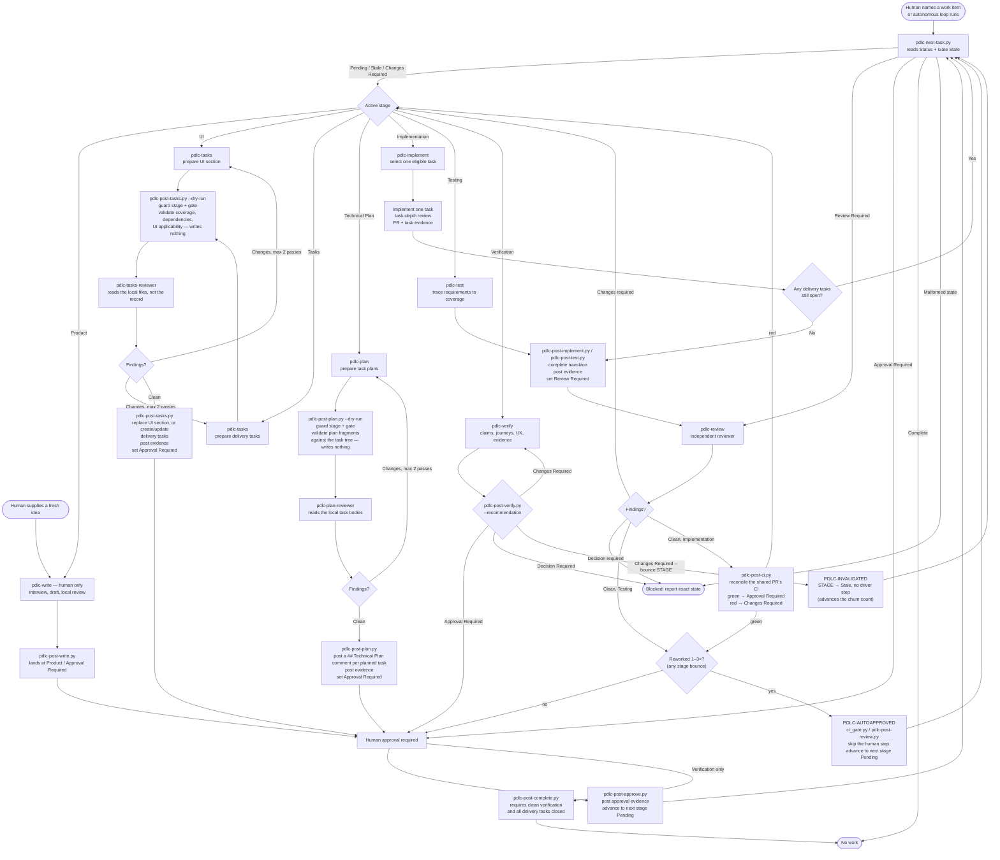

# PDLC workflow

This flow describes how the parent work item, its state, delivery tasks,
and pull requests work together. The work item store is the system of record;
the focused scripts enforce every work item mutation.

## Gate states per stage

Every `Status` stage carries the same `Gate State` shape, transitioned by a
fixed script and actor. Most stages depart from it. `Product`, `UI`, `Tasks`,
and `Technical Plan` are reviewed **before** publication, so they land straight
at `Approval Required` and never hold `Review Required` — and because
`pdlc-post-review.py` is the only thing that sets `Changes Required`, they never
hold that either. Their gate set is `Pending`, `Stale`, `Approval Required`,
`Approved`, and a landed artifact is reworked by returning it to `Stale`.
When the driver asks for a change while one of these stages is still at
`Approval Required`, its own land script (`pdlc-post-write.py` /
`pdlc-post-tasks.py` / `pdlc-post-plan.py`) resets the gate to `Stale` itself
and re-lands the reviewed artifact in the same call. No `PDLC-INVALIDATED`
comment: the artifact never settled at `Approved`, so there is nothing to
invalidate, and the re-land's own stage evidence records the change. Nothing
about it feeds the rework/churn count.
`Testing` keeps the full post-publication review shape; `Implementation` stays
`Pending` across multiple task loops before its first `Review Required`;
`Verification` skips `Review Required` entirely.

`Implementation` has one extra gate: a clean stage review lands `CI Pending`,
not `Approval Required`, because the reviewer judges the code without waiting on
the shared PR's CI. `pdlc-post-ci.py` then reconciles `CI Pending` against the
live check rollup — green (or no checks configured) → `Approval Required`, red →
`Changes Required` with a `PDLC-IMPLEMENTATION` note. It is mechanical, carries
no identity check, and the autonomous loop runs it unattended once checks
finish; while they run, `pdlc-next-task.py` reports the record as no work so the
loop backs off. `Testing` still lands `Approval Required` straight from review.

Both `Implementation` and `Testing` approval gates are auto-cleared on a record
that has demonstrably iterated the rework loop. When
`sum(invalidations_by_stage(comments).values())` — the count of
`Invalidated stage: <STAGE>` events in comment history, across every stage — is
between 1 and `PDLC_AUTOAPPROVE_CHURN_CAP` (default 3), the script that would set the gate
advances straight past it instead: `lib/ci_gate.py` on green CI and
`pdlc-post-review.py` on a clean Testing review post a `PDLC-AUTOAPPROVED`
comment and `set_state` to the next stage's `Pending`, so no human step and no
later routing pass is involved. On the first pass, past the cap, and for
`Verification` always, the gate still stops for the driver.
`PDLC_AUTOAPPROVE_CHURN_CAP=0` disables it. The loop count is advanced by
`pdlc-post-verify.py --bounce STAGE`: on a `Changes Required` run the verifier
returns the named upstream stage to `Stale` itself (a `PDLC-INVALIDATED`
comment, same effect as `pdlc-post-invalidate.py`) with no driver step, so the
Implementation → Testing → Verification loop keeps moving autonomously until a
finding needs a human decision or the cap is hit.

Both post-publication reviews (`Implementation`, `Testing`) can also land at
`Decision Required` instead of `Changes Required` when a finding needs a
product, architecture, UX, safety, or scope call from the driver, and
`Verification` can reach the same gate from its own audit
(`pdlc-post-verify.py --recommendation "Decision Required" --decision`). That
gate stops the autonomous loop with no reconciliation attempt;
`pdlc-next-task.py` routes it to `human-decision`. The driver clears it through
`references/decision-resolver-workflow.md`: `pdlc-post-decision.py` lands a
manifest of per-decision outcomes — each answered, or deferred into its own
`Product / Pending` work item — and moves the gate to `Changes Required`,
routing back to the stage owner. A decision that changes approved upstream
intent goes through `pdlc-post-invalidate.py` instead.

```mermaid
stateDiagram-v2
    [*] --> Product : pdlc-post-write.py — pdlc-write (human), reviewed spec only

    state Product {
        [*] --> P_Approval
        P_Pending --> P_Approval : pdlc-post-write.py — pdlc-write (human)
        P_Changes --> P_Approval : pdlc-post-write.py — pdlc-write (human)
        P_Stale --> P_Approval : pdlc-post-write.py — pdlc-write (human)
        P_Approval --> P_Approval : pdlc-post-write.py — driver change request (gate reset to Stale first, no comment)
    }
    note left of Product
        Product has no Review Required state: pdlc-write
        drafts and has the specification reviewed locally
        before anything is written to the work item store.
    end note
    Product --> UI : pdlc-post-approve.py — human

    state UI {
        [*] --> U_Pending
        U_Pending --> U_Approval : pdlc-post-tasks.py — pdlc-tasks
        U_Stale --> U_Approval : pdlc-post-tasks.py — pdlc-tasks
        U_Approval --> U_Approval : pdlc-post-tasks.py — driver change request (gate reset to Stale first, no comment)
    }
    note left of UI
        UI and Tasks have no Review Required state: pdlc-tasks
        has pdlc-tasks-reviewer review the manifest and files
        before pdlc-post-tasks.py writes anything to the work item store.
    end note
    UI --> Tasks : pdlc-post-approve.py — human

    state Tasks {
        [*] --> T_Pending
        T_Pending --> T_Approval : pdlc-post-tasks.py — pdlc-tasks
        T_Stale --> T_Approval : pdlc-post-tasks.py — pdlc-tasks
        T_Approval --> T_Approval : pdlc-post-tasks.py — driver change request (gate reset to Stale first, no comment)
    }
    Tasks --> TechnicalPlan : pdlc-post-approve.py — human

    state TechnicalPlan {
        [*] --> TP_Pending
        TP_Pending --> TP_Approval : pdlc-post-plan.py — pdlc-plan
        TP_Stale --> TP_Approval : pdlc-post-plan.py — pdlc-plan
        TP_Approval --> TP_Approval : pdlc-post-plan.py — driver change request (gate reset to Stale first, no comment)
    }
    note left of TechnicalPlan
        Technical Plan has no Review Required state:
        pdlc-plan has pdlc-plan-reviewer review the rebuilt
        task bodies before pdlc-post-plan.py writes any of them.
    end note
    TechnicalPlan --> Implementation : pdlc-post-approve.py — human

    state Implementation {
        [*] --> I_Pending
        I_Pending --> I_Pending : pdlc-implement — one task + PR per pass, any delivery task still open
        I_Pending --> I_Review : pdlc-post-implement.py — pdlc-implement, only once every delivery task is closed
        I_Changes --> I_Review : pdlc-post-implement.py — pdlc-implement
        I_Stale --> I_Review : pdlc-post-implement.py — pdlc-implement
        I_Review --> I_Changes : pdlc-post-review.py — pdlc-review (reviewer)
        I_Review --> I_Decision : pdlc-post-review.py — pdlc-review (reviewer), finding needs the driver
        I_Review --> I_CIPending : pdlc-post-review.py — pdlc-review (reviewer), clean review does not wait for CI
        I_CIPending --> I_Approval : pdlc-post-ci.py — CI green, or no checks configured
        I_CIPending --> I_Changes : pdlc-post-ci.py — CI red, PDLC-IMPLEMENTATION note
        I_Decision --> I_Changes : pdlc-post-decision.py --manifest — driver (each decision answered or deferred to its own work item)
    }
    Implementation --> Testing : pdlc-post-approve.py — human
    Implementation --> Testing : pdlc-post-ci.py — CI green + reworked 1–3× (PDLC-AUTOAPPROVED, no human)

    state Testing {
        [*] --> Te_Pending
        Te_Pending --> Te_Review : pdlc-post-test.py — pdlc-test
        Te_Changes --> Te_Review : pdlc-post-test.py — pdlc-test
        Te_Stale --> Te_Review : pdlc-post-test.py — pdlc-test
        Te_Review --> Te_Changes : pdlc-post-review.py — pdlc-review (reviewer)
        Te_Review --> Te_Decision : pdlc-post-review.py — pdlc-review (reviewer), finding needs the driver
        Te_Review --> Te_Approval : pdlc-post-review.py — pdlc-review (reviewer)
        Te_Decision --> Te_Changes : pdlc-post-decision.py --manifest — driver (each decision answered or deferred to its own work item)
    }
    Testing --> Verification : pdlc-post-approve.py — human
    Testing --> Verification : pdlc-post-review.py — clean review + reworked 1–3× (PDLC-AUTOAPPROVED, no human)

    state Verification {
        [*] --> V_Pending
        V_Pending --> V_Changes : pdlc-verify — finding (no Review Required stop)
        V_Pending --> V_Approval : pdlc-verify — clean report
        V_Pending --> V_Decision : pdlc-verify — finding needs the driver
        V_Changes --> V_Changes : pdlc-verify — finding persists
        V_Changes --> V_Approval : pdlc-verify — clean report
        V_Changes --> V_Decision : pdlc-verify — finding needs the driver
        V_Decision --> V_Changes : pdlc-post-decision.py --manifest — driver
        V_Stale --> V_Changes : pdlc-verify — finding
        V_Stale --> V_Approval : pdlc-verify — clean report
    }
    Verification --> Implementation : pdlc-post-verify.py --bounce STAGE — Changes Required, autonomous (STAGE → Stale, PDLC-INVALIDATED)
    Verification --> Complete : pdlc-post-complete.py — explicit human instruction

    Complete --> [*]

    note right of Product
        Any stage's Approved/settled state can return to that
        stage's Stale via pdlc-post-invalidate.py (human) when
        upstream intent changes, or — for a Verification
        Changes Required run — via pdlc-post-verify.py --bounce
        STAGE with no driver step.
        A stage declared in Skipped States (pdlc-post-skip.py, human)
        is auto-advanced Pending/Changes/Stale straight to the
        next stage's Pending by pdlc-next-task.py, bypassing its
        specialist and reviewer entirely.
        On a record reworked 1–3× (any stage bounce), the
        Implementation and Testing Approval Required gates are
        auto-cleared (PDLC-AUTOAPPROVED) by ci_gate.py /
        pdlc-post-review.py — no human, capped by
        PDLC_AUTOAPPROVE_CHURN_CAP.
        Product, UI, Tasks, and Technical Plan reach Approval
        Required directly; their review happens on local files
        beforehand and leaves no gate state of its own. A driver
        change request while one of them is still at Approval
        Required is handled by its own land script: it resets
        the gate to Stale itself (no comment, no churn) and
        re-lands in the same call.
    end note
```

A skipped `Verification` stage stops at `Verification / Approval Required` rather than auto-completing because completion always requires an explicit `pdlc-post-complete.py` instruction from the driver.

`pdlc-post-tasks.py` and `pdlc-post-plan.py` land a stage at `Approval Required` without
an intervening reviewer gate, so the review each depends on happens inside its
skill, before the call. They, `pdlc-post-implement.py`, `pdlc-post-test.py`, and `pdlc-post-review.py` are the
only scripts a specialist or reviewer agent runs unattended; `pdlc-post-approve.py`, `pdlc-post-invalidate.py`,
`pdlc-post-skip.py`, `pdlc-post-complete.py`, and `pdlc-post-decision.py` carry no
identity check — every agent acts under the driver's own store credentials — so only the orchestrator
calls them, and only in direct response to an explicit human instruction in this turn.
`pdlc-post-write.py`, `pdlc-post-tasks.py`, and `pdlc-post-plan.py` additionally
reset their own stage's `Approval Required` gate to `Stale` when re-landing on a
driver change request (a bare gate transition, no comment), so that rework needs
no separate `pdlc-post-invalidate.py` step.
`pdlc-next-task.py`'s skip-cascade and `pdlc-post-ci.py`'s CI reconciliation are
fully automatic gate transitions with no live actor — both record an external
fact rather than a judgement, so the loop runs them unattended and a driver may
also run `pdlc-post-ci.py` directly when resuming a `CI Pending` record. The
churn gate is the other one: `lib/ci_gate.py` (green CI) and
`pdlc-post-review.py` (clean Testing review) clear the `Implementation` /
`Testing` `Approval Required` step with a `PDLC-AUTOAPPROVED` comment on a
record that has been reworked 1–`PDLC_AUTOAPPROVE_CHURN_CAP`
times (any stage bounce), and `pdlc-post-verify.py --bounce STAGE` performs the matching
`Verification → upstream` invalidation autonomously. All three still stop the
loop the moment a reviewer or the audit returns `Decision Required`, and the
churn gate reverts to a human stop past the cap and for `Verification` always.

## Implementation aggregation

The parent work item remains `Implementation / Pending` after each task
completion. It may enter `Implementation / Review Required` only after every
delivery task is closed with settled evidence. This prevents testing or
verification from starting after only the first implementation task.
