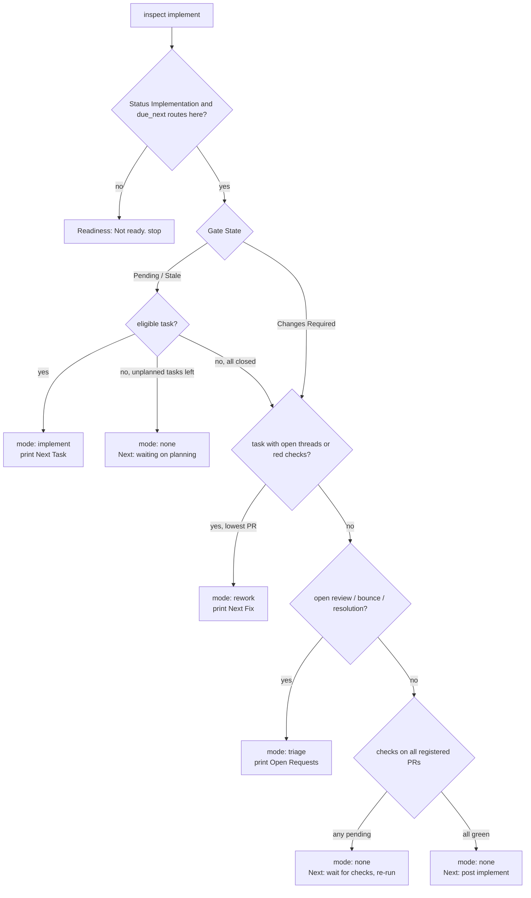
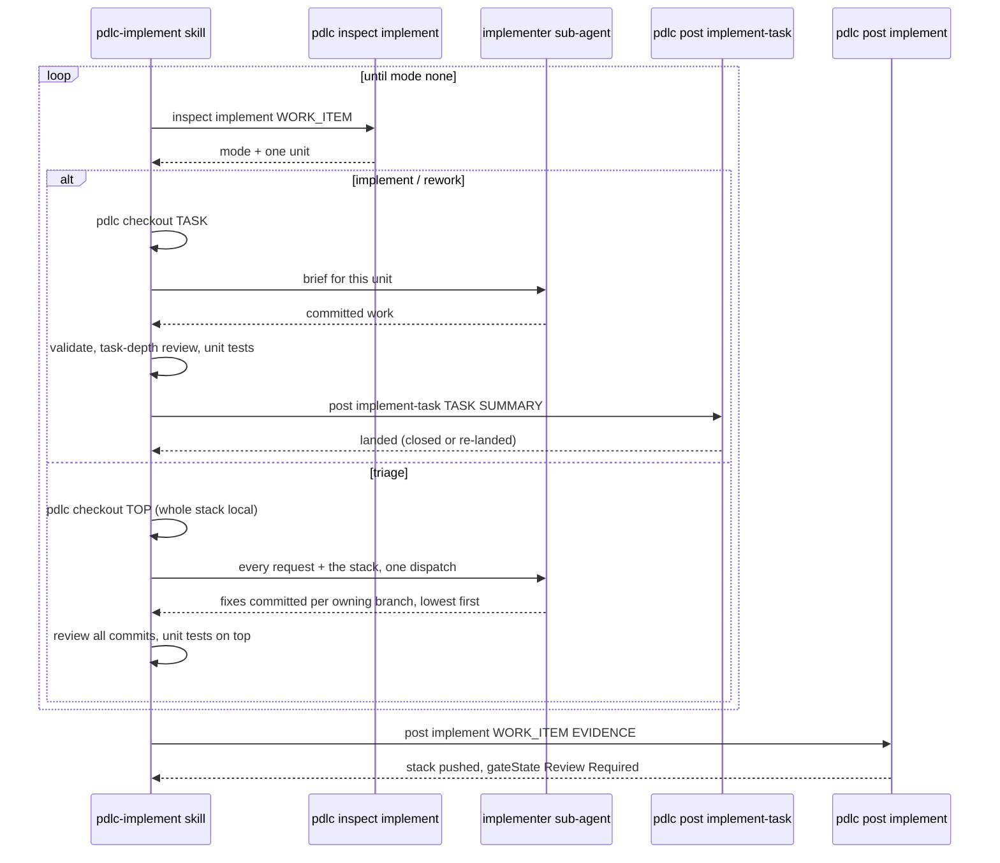
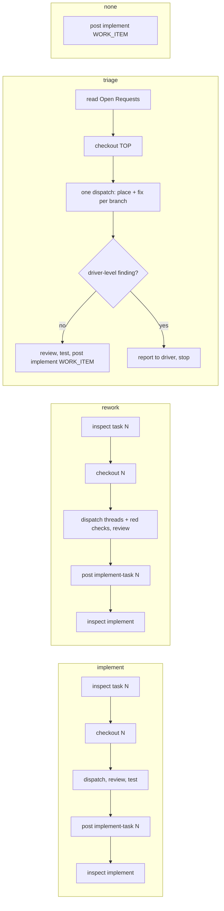

# Implementation modes — CLI-driven `inspect implement` / `post implement-task`

Status: implemented, CLI and skill. `pdlc-implement` and its references follow this contract; `rework.md` is gone.

## Goal

`pdlc inspect implement` decides the mode from machine state and prints exactly one unit of work per call. The agent loops: inspect, do the unit, land it, inspect again, until the CLI says there is nothing left and names the publish command. The skill stops carrying a gate-state table, a PR-comment override, or a "rework" procedure that re-derives stack order by hand.

`pdlc post implement-task` detects the same mode from the task's state, so `--close` becomes implicit and a re-land on a closed task is the default, not a flag the skill has to remember to drop.

`--task` and `--phase` are removed from `inspect implement`. The CLI owns the order; a driver who wants a specific task next changes the record, not the scan. The agent still reaches any task directly through `pdlc inspect task N` and `pdlc checkout N`, which is all `triage` needs.

## Modes

| `mode` | When | Unit printed | Done when |
|---|---|---|---|
| `implement` | gate `Pending` or `Stale`, an eligible task exists | one task, CORE-before-UI then number | that task lands and closes |
| `rework` | a task with unresolved threads or a red check exists; under `Pending` / `Stale` only once no eligible task remains | one task, lowest PR in the stack first | its threads are resolved and its PR is not red |
| `triage` | gate `Changes Required`, no task unit left, open prose requests exist | the whole-item change requests, once: one dispatch places and fixes each finding on its owning branch, `post implement` pushes the stack | the stage publishes |
| `none` | nothing eligible, no task unit, nothing open | nothing | prints the CI gate result: publish, wait, or the reason nothing is due |

Under `Pending` and `Stale`, new tasks come first. Threads and red checks are consulted only once no eligible task remains, so a pending run stays single-purpose until the last task lands, then the same rework loop runs before publishing. Under `Changes Required` there are no new tasks, so rework units come first.

## Change-request sources and their done signals

| Source | Lands on | Attributed to a task by | Done signal |
|---|---|---|---|
| PR review threads | a PR, therefore its task | PR number in the task's `prs` | no unresolved threads on that PR, live |
| `ci` note | work item | each registered PR whose checks are red, live | that PR is no longer red, live; pending counts as not red |
| `invalidation` | work item, per-task effect | `implementationInvalidated` flag | task re-implemented, flag cleared (this is `Stale`) |
| `review` findings | work item | not attributed, prose | stage publishes |
| `bounce` from Verification | work item | not attributed, prose | stage publishes |
| `resolution` of a decision | work item | not attributed, prose | stage publishes |
| `decision` required | work item | never a fix unit | driver resolves; `due_next` routes it away from this skill |

The prose three are never parsed for task ids or file paths. They form the single `triage` unit and are printed after every task-attributed unit is done. Publishing is their existing done signal, and the stage review re-checks the claim. No new markers, no new persisted state.

## Ordering

1. Under `Pending` / `Stale` only: the next eligible task, `mode: implement`. Repeats until none is eligible.
2. Task units in stack order, lowest PR first, because re-landing a task rebases every branch above it. A unit is a task with at least one unresolved thread or a red check on its PR. `mode: rework`.
3. `triage`, once, when no task unit remains and at least one prose request is open. Only `Changes Required` can have these.
4. `none`, with the CI gate below.

Steps 2 to 4 are one function of live host state, called with the same inputs whatever the gate. The gate only decides whether step 1 runs before them.

## CI gate

Check state is read live per registered PR and classified as green, red, or pending (queued or running, or no checks reported yet).

- Red makes that task a `rework` unit, in stack order like any other.
- Pending never makes a unit and never blocks the next unit. The loop keeps moving so a re-land's checks run while the next task is worked.
- `none` is where pending is settled. With every task unit done and no prose request open, `inspect implement` reads all registered PRs: all green prints `Next: pdlc post implement`; any pending prints `Next: wait for checks, then re-run`; any red is a `rework` unit again, so the mode is `rework`, not `none`.

The same rule applies under `Pending` and `Stale` once every task is closed: threads and red checks are fixed through `rework` and `none` gates on CI before naming the publish command, so a reviewer's early comment or a red check on the last task's PR is handled before publishing rather than caught by the stage review or `post ci` afterwards.

## Flows

### Mode decision in `inspect implement`



Red checks are already caught at `E`, so `G` only distinguishes pending from green. Everything from `E` down is gate-independent.

### Agent loop, all modes



### What each mode tells the agent

Every mode ends with the unit section, whose `Next:` sentence says where to go and what to do there, followed by `## Publish`, the one mutating command that lands this unit or the stage. The skill's loop is: follow `Next`, run `Publish`, re-run `inspect implement`.



## `pdlc inspect implement` output per mode

Section order is fixed across modes: `## Readiness`, `## Mode`, `## Attachments`, `## Checks` (only at the CI gate), the unit section (`## Next Task`, `## Next Fix`, or `## Open Requests`), then `## Publish` last. The unit section ends, after a blank line, with a `Next:` sentence summarising the hop to make and what to do there; `## Publish` holds the one mutating command.

### `mode: implement`

```md
## Readiness

Ready — Gate State: Pending.

## Mode

mode: implement

## Attachments

None

## Next Task

### WORK-142-TASK-004 [UI] Route profile chart
number: 51
taskId: TASK-004
isUI: true
branch: pdlc/record-142/task-004

Next: Run `pdlc inspect task 51` for the task body, acceptance criteria, technical plan, and the implementer sub-agent under `## Agent`, then `pdlc checkout 51` and dispatch that sub-agent to implement the task on the checked-out branch.

## Publish

After the task is implemented and its files are committed, run `pdlc post implement-task 51 SUMMARY` to record the implementation, open the task's PR, and close the task.
```

`Stale` prints the same with an extra block under `## Next Task`, before `Next:`:

```md
reconcile: implementation invalidated on 2026-09-12 — re-read the task body and plan against the invalidation below before implementing

#### Invalidation
<full PDLC-INVALIDATED comment body>
```

### `mode: rework`

```md
## Readiness

Ready — Gate State: Changes Required.

## Mode

mode: rework

## Attachments

None

## Next Fix

### WORK-142-TASK-002 [CORE] Chart data loader
number: 49
taskId: TASK-002
pr: 151
branch: pdlc/record-142/task-002
state: CLOSED

This task is already implemented and its current changes are published in PR #151. Run `pdlc checkout 49` to put the working tree on that PR's branch; every fix below lands as a new commit on top of it, after the implementer has investigated the current implementation.

#### Unresolved threads (2)
- @reviewer on src/chart.py:42 — this drops the retry (https://.../#discussion_r1)
- @reviewer on src/chart.py:80 — missing null guard (https://.../#discussion_r2)

#### Failing checks (1)
- build (https://.../checks/123)

Next: Run `pdlc inspect task 49` for the implementer sub-agent under `## Agent`, then dispatch that sub-agent to fix every thread and failing check above on the checked-out branch.

## Publish

After every thread and failing check above is fixed and the files are committed, run `pdlc post implement-task 49 SUMMARY` to re-land the fix on the task's PR; the task stays closed.
```

`#### Unresolved threads` and `#### Failing checks` are omitted when empty. `#### Decisions` appears when a `PDLC-RESOLUTION` is open against the stage: each resolution comment in full, so a thread the agent escalated on an earlier pass (skipped, left untouched, raised through `pdlc post escalate`) is settled per the driver's answer when its unit comes round again rather than escalated twice. Thread and check state is live host state, so the next call moves on by itself. A PR with only pending checks is never the unit.

### `mode: triage`

```md
## Readiness

Ready — Gate State: Changes Required.

## Mode

mode: triage

## Attachments

None

## Open Requests

Every delivery task is already implemented and published in the PR stack below; these requests ask for changes to that implemented work. Run `pdlc checkout NUMBER` with the top task's number to put the working tree on the top branch with every task branch of the stack local. Each fix lands as a new commit on the branch of the task it belongs to, lowest first; a fix with no clear owner, or one that needs a lower fix to build on, goes on the top branch. These requests stay listed until the stage publishes, so this unit is offered again until then.

### Review findings — 2026-09-14 (https://.../comment-1)
<full comment body>

### Verification bounce — 2026-09-15 (https://.../comment-2)
<full comment body>

#### Stack
- WORK-142-TASK-002 (number 49, PR #151)
- WORK-142-TASK-003 (number 50, PR #152)
- WORK-142-TASK-004 (number 51, PR #153, top)

Next: Run `pdlc inspect task NUMBER` for each task in the stack for its technical plan, and for the top task's implementer sub-agent under `## Agent`; then dispatch that sub-agent once with every request above and the stack, to place and fix each finding on its owning task's branch.

## Publish

After every fix is committed on its task branch, run `pdlc post implement 142 EVIDENCE` from the top branch to push the whole stack and publish the stage; the evidence names how each request was addressed.
```

### `mode: none`

```md
## Readiness

Ready — Gate State: Pending.

## Mode

mode: none

## Attachments

None

## Checks

- PR #151: green
- PR #152: green
- PR #153: green

## Next Task

None. Every delivery task is closed. Continue the workflow with the command under `## Publish`.

## Publish

Run `pdlc post implement 142 EVIDENCE` to publish the stage at Review Required.
```

With a check still running:

```md
## Checks

- PR #151: green
- PR #152: pending
- PR #153: green

## Next Task

None. Every delivery task is closed. Continue the workflow with the command under `## Publish`.

## Publish

Run `pdlc post implement 142 EVIDENCE` to publish the stage at Review Required.
```

With a red check the mode is `rework` for that PR's task, not `none`.

Under `Pending` with every task closed and a reviewer thread still open, the mode is `rework` with that task as the unit, exactly as under `Changes Required`; the `## Readiness` line still reads `Gate State: Pending`.

Under `Pending` with unplanned tasks left, no `## Checks`:

```md
## Next Task

None. WORK-142-TASK-005 has no technical plan yet.

## Publish

Nothing to publish yet.
```

### Inconsistent records

A task that is OPEN but already carries a non-invalidated `## Implementation` is neither eligible nor a rework unit. Rather than skipping it silently, `## Readiness` reports it and the output stops there:

```md
## Readiness

Not ready: WORK-142-TASK-003 (number 50) has an implementation recorded but is still open. Close it with `pdlc post implement-task 50 SUMMARY` or reopen its implementation with `pdlc post invalidate`.
```

There is no `## Remaining` section and no progress counter. One unit per call means the agent has no use for the queue; `pdlc inspect WORK_ITEM` reports overall progress for the skill's report.

## `pdlc post implement-task` per mode

The command reads only the task's state; it never reads the record's gate and there is no mode flag. `--close` stays accepted for one release as a no-op with a deprecation note.

| Task state | Behaviour |
|---|---|
| OPEN, no `## Implementation` | submit stacked PR, set title/body, record PR, write comment, close task |
| OPEN, invalidated `## Implementation` | same, replacing the comment in place |
| CLOSED | resubmit stack, replace comment and PR body, task stays closed |

Output, `implement` / `Stale`:

```json
{"commented": true, "task": 51, "mode": "implement", "closed": true,
 "attachments": [], "taskPr": {"number": 153, "url": "..."}, "prs": [153]}
```

Output, `rework`:

```json
{"commented": true, "task": 49, "mode": "rework", "closed": true, "relanded": true,
 "attachments": [], "taskPr": {"number": 151, "url": "..."}, "prs": [151],
 "openThreads": 0, "checks": "pending"}
```

`openThreads` and `checks` are read live after the re-land so the agent sees whether the unit will still be offered on the next inspect. A non-zero `openThreads` means the sub-agent did not resolve every thread; the skill dispatches again or reports. `checks` is normally `pending` right after a push; that does not hold the loop, the next inspect moves to the next unit and the CI gate at `none` settles it.

There is no gate-based refusal and no guard against re-landing a closed task nobody asked about; the skill only calls this from a unit `inspect implement` printed. Existing failure modes (dirty tree, submit failure, missing PR) are unchanged and still leave no comment and no closure.

## `pdlc post implement` per mode

Unchanged in shape. It refuses while any delivery task is open. Under `Changes Required` the evidence is expected to name each open request and how it was addressed; the command does not check that, the stage review does.

```json
{"completed": true, "itemId": "PVTI_x", "work_item": 142, "stage": "Implementation",
 "gateState": "Review Required", "attachments": [],
 "readyPullRequests": [{"number": 151, "url": "..."}, {"number": 153, "url": "..."}]}
```

It resolves no pull request from the working tree: the record's pull requests come
from the registry its delivery tasks carry, so the branch left checked out by the
last pass — a `rework` fix on a lower task, for instance — does not matter.

## Implementation steps (CLI only)

1. `src/pdlc/commands/inspect_implement.py`: add mode resolution, `## Mode`, `## Next Fix`, `## Open Requests`, `#### Stack`, `## Checks`, per-mode `## Publish` and `Next:` lines, and the inconsistent-record readiness refusal. Drop `## Remaining` and `## Judgment Required` (its checks live in the skill), drop the always-on `## Open Comments` and the `--task` / `--phase` flags with their scoping code and tests. Reuse `open_change_requests` for the prose requests and `record_open_review_comments` plus a new live check read for task units.
2. `src/pdlc/hosts/code_host/base.py` and the GitHub / file / none implementations: a `pull_request_checks(numbers)` read returning green / red / pending per PR, if `post ci` does not already expose one reusable here. The `none` host reports every PR as green so the CI gate is a no-op without a code host.
3. `src/pdlc/commands/post_implement_task.py`: derive mode from task state alone, make close implicit, add `mode`, `relanded`, `openThreads`, `checks` to the JSON. Keep `--close` as a no-op.
4. Docstrings for both commands and the top-level `_usage()` one-liners; `inspect implement` becomes `pdlc inspect implement WORK_ITEM` with no flags.
5. Tests in `tests/test_inspectors.py` and the `post implement-task` tests with the file backend: one scenario per mode, plus the ordering.
6. Skills, `rework.md`, `fix-pr-comments.md` in a follow-up once the output is settled.

## Decisions

- `Stale` prints the invalidation comment inline under `reconcile:`, so the unit is self-contained like `rework` and `triage` are.
- `post implement-task` always takes the whole summary; there is no append form. One contract, the summary is the whole implementation.
- A review thread the implementer judges invalid or out of plan is skipped and left untouched on the host; the skill lands the other fixes, then escalates every skipped thread with `pdlc post escalate` (a stage owner's move from a work gate to `Decision Required`, since `pdlc post review decision-required` needs `Review Required`), carrying the agent's response. The driver closes a thread that does not apply or leaves it open to have it applied. The `PDLC-RESOLUTION` rides with the rework unit under `#### Decisions`, and a thread named there that is still open is approved. No new markers; one new transition, `escalated`.
